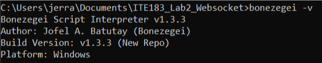
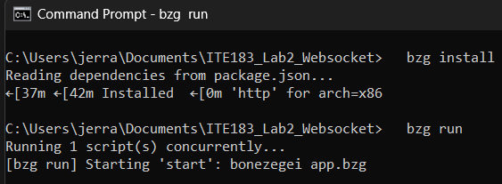
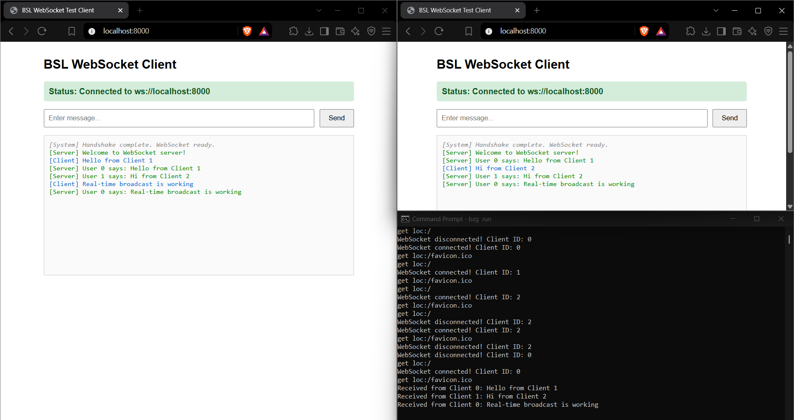
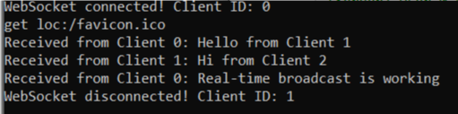
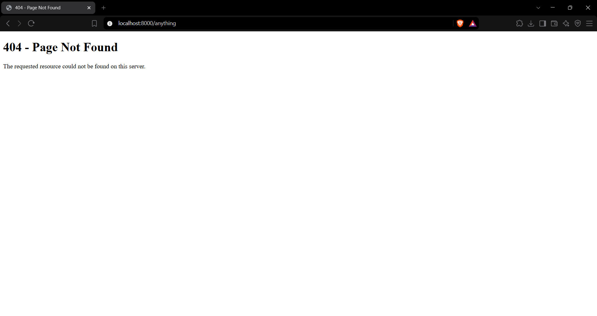

# ITE183_Lab2_Websocket

**ITE183 – Web Systems and Technologies | Laboratory 2: WebSocket Server**

| | |
|---|---|
| **Name** | Jerrald Stephen M. Cañoneo |
| **Section** | IT4N |
| **Program** | BSIT – Network Technology |
| **Institution** | MSU-IIT |
| **Date** | October 26, 2026 |
| **Runtime** | Bonezegei Scripting Language v1.3.3 |

---

## 1. Overview

This project is an event-driven HTTP and WebSocket chat server built with the Bonezegei Scripting Language (BSL) and its `http` package. The server:

- serves a static multi-client chat interface (`public/index.html`) at `/`;
- returns a custom 404 page (`public/404.html`) for every undefined route;
- upgrades browser connections from HTTP to WebSocket and assigns each client a unique ID;
- broadcasts every received message to all connected clients in real time using `server.sendAll()`;
- logs connection, message, and disconnection events to the terminal.

## 2. Objectives

1. Construct and run an event-driven WebSocket server using BSL for full-duplex communication.
2. Implement connection lifecycle handling: socket handshakes, client identification, and disconnection tracking.
3. Develop real-time message broadcasting across active connections for multi-client interactivity.

## 3. Project Structure

```text
.
├── .gitattributes      # *.bzg highlighted as JavaScript on GitHub
├── .gitignore          # excludes lib/ and local runtime DLLs
├── LICENSE             # MIT License
├── README.md           # project documentation and lab report
├── app.bzg             # HTTP + WebSocket server (port 8000)
├── package.json        # Bonezegei package manifest (depends on http)
├── public/
│   ├── index.html      # multi-client WebSocket chat client
│   └── 404.html        # custom 404 page
└── screenshots/        # lab report evidence
```

## 4. Repository Configuration

| Requirement | Implementation |
|---|---|
| Public repository named `ITE183_Lab2_Websocket` | Created on GitHub |
| README and MIT License | Initialized on creation; README extended into this report |
| `.gitattributes` | Contains `*.bzg linguist-language=JavaScript` for syntax highlighting |
| Dependencies | `lib/` is generated by `bzg install` and excluded via `.gitignore` |

## 5. Implementation

### 5.1 Package Manifest (`package.json`)

Declares `app.bzg` as the entry point, the `start` script (`bonezegei app.bzg`) executed by `bzg run`, and the `http` package as a dependency installed by `bzg install`.

### 5.2 Server Logic (`app.bzg`)

The server loads the `http` library and listens on port 8000. Behavior is defined through event handlers:

| Handler | Trigger | Behavior |
|---|---|---|
| `server.get(path, data)` | HTTP GET request | Serves `public/index.html` for `/`; serves `public/404.html` for any other path |
| `server.onConnect(clientId)` | WebSocket handshake completes | Logs the client ID and sends that client a welcome message with `server.send()` |
| `server.onData(message, clientId)` | Client sends a message | Logs the message and broadcasts `"User <id> says: <message>"` to all clients with `server.sendAll()` |
| `server.onDisconnect(clientId)` | Client closes the connection | Logs the disconnected client ID |

`server.run()` starts the event loop that dispatches these handlers.

### 5.3 Chat Client (`public/index.html`)

The page opens a persistent connection to `ws://localhost:8000` and handles the four WebSocket events:

- `onopen` – shows a green "Connected" status and enables the input field;
- `onmessage` – appends server messages to the log (green);
- `onclose` – shows a red "Disconnected" status and disables the input field;
- `onerror` – logs an error notice.

Messages sent by the user appear in blue as `[Client]`; broadcasts received from the server appear in green as `[Server]`.

## 6. Setup and Execution

```bash
# verify the runtime version
bonezegei -v

# install all dependencies
bzg install

# run the app
bzg run
```

Open `http://localhost:8000` in two or more browser windows to test the chat. Stop the server with `Ctrl+C`.

## 7. Results and Verification

### 7.1 Runtime Version

`bonezegei -v` confirms Bonezegei Script Interpreter **v1.3.3** on Windows.



### 7.2 Dependency Installation and Server Startup

`bzg install` reads `package.json` and installs the `http` package. `bzg run` executes the `start` script, and the server begins listening on port 8000 without errors.



### 7.3 Multi-Client Real-Time Broadcasting

Two browser windows are connected to the server at the same time. Each message sent from one client is broadcast to every connected client:

- Client 0 sent "Hello from Client 1" and "Real-time broadcast is working".
- Client 1 sent "Hi from Client 2".
- Both windows display all three messages as `[Server] User <id> says: ...`, confirming that `server.sendAll()` delivers each payload to all active connections.

The terminal (bottom right) records the connection lifecycle: HTTP requests (`get loc:/`), WebSocket handshakes with assigned client IDs, received messages per client, and disconnections from earlier page reloads.



### 7.4 Disconnection Tracking

Closing the second browser window triggers `server.onDisconnect`, and the server logs the disconnected client ID.



### 7.5 Custom 404 Page

Requesting an undefined route (`/anything`) returns the custom `public/404.html` page instead of the chat client.



## 8. Observations

1. **Client identification.** Each WebSocket connection receives an index-based client ID. IDs are reused after a client disconnects, which is why a reloaded page can return with the same ID.
2. **Full duplex.** The server pushes messages (the welcome message and broadcasts) without the client sending an HTTP request, and clients send messages at any time over the same open connection.
3. **Echo vs. broadcast.** `server.send(clientId, ...)` targets one client and is used for the welcome message; `server.sendAll(...)` targets every client and is used for chat messages. The sender therefore receives its own message back as a broadcast.
4. **404 status code.** `server.sendFile()` sends the custom 404 page with an HTTP 200 status. The page renders correctly; returning an actual 404 status would require `server.sendResponse(content, "text/html", 404)`.
5. **Windows runtime dependency.** On Windows, `lib/http/http.dll` failed to load until `libwinpthread-1.dll` (a MinGW runtime file, obtained from the Git for Windows installation) was placed in the project folder. This file is excluded from the repository through `.gitignore`.

## 9. Conclusion

The laboratory produced a working event-driven WebSocket server in Bonezegei v1.3.3. The server serves static files, handles undefined routes with a custom 404 page, performs the HTTP-to-WebSocket upgrade, identifies each client, tracks disconnections, and broadcasts messages to all connected clients in real time, as verified across concurrent browser sessions.

## 10. License

This project is licensed under the [MIT License](LICENSE).
